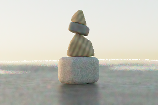
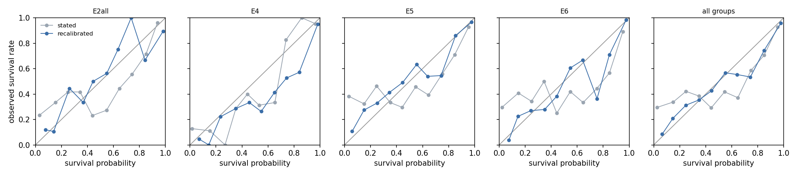
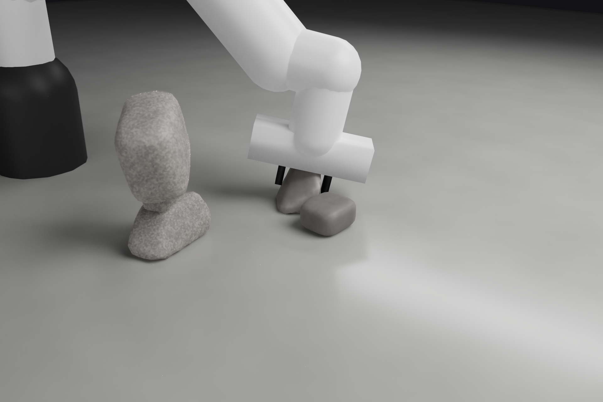
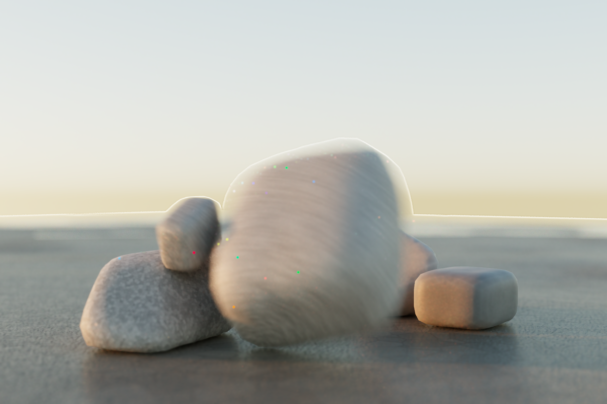
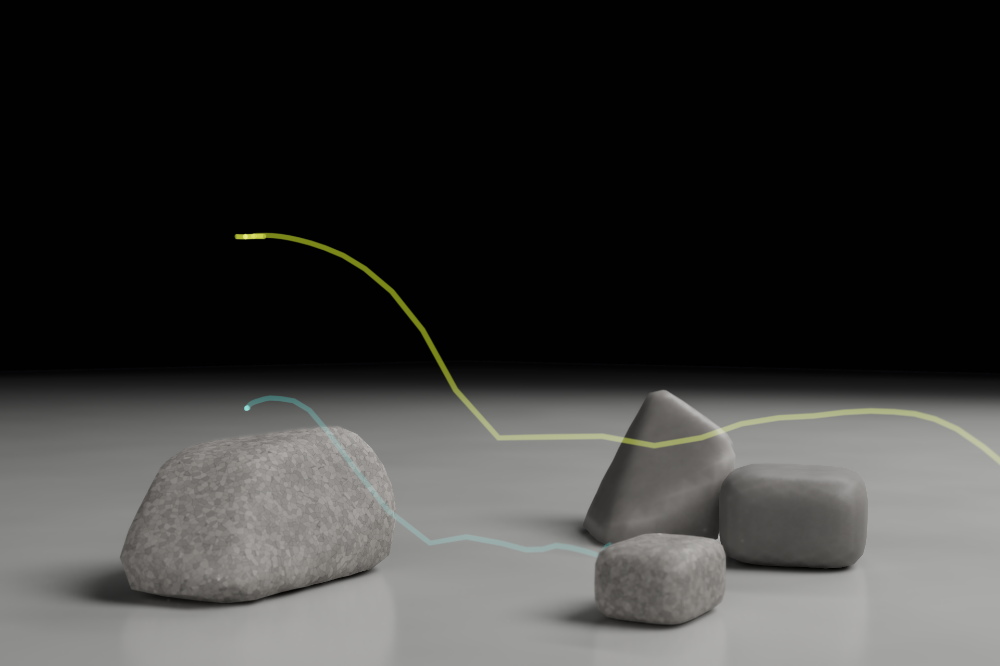
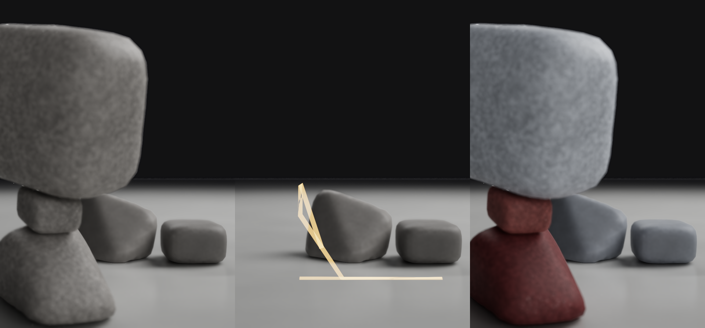

# topple

Calibrated stone balancing with a simulated robot arm. A simulated 7 degree of freedom arm
stacks irregular stones into a tower. Before every release the system states a stability
margin with an uncertainty distribution and a probability that the tower survives a test
protocol. The simulator then measures the true margin and the outcome, and the agreement
between prediction and measurement (calibration) is the primary result.

Every module is written for this project: stone generator, rigid body solver, static
stability analyser, simulated depth sensor and estimator, planner, arm controller, path tracer
and evaluator. The rigid body solver is cross checked against MuJoCo, Drake and PyBullet.



## Results at a glance

Study scale: 24 towers per condition, 95% bootstrap intervals over towers. The full write up,
with every table and the command that produced it, is in [results/REPORT.md](results/REPORT.md).

| Question | Result |
| --- | --- |
| With exact inputs, does the static margin predict the measured critical tilt? (E1) | It ranks it well (Spearman 0.83 on single stones) and reads about 3 degrees high. The rocking aware margin added here brings the bias to -0.6 degrees and the RMSE from 6.1 to 3.5 degrees. |
| Under perception, which propagation method states the best calibrated survival probability? (E2) | Monte Carlo (ECE 0.16, Brier 0.21). The point estimate is overconfident (ECE 0.44). |
| Final method: Monte Carlo with a learned recalibration step | Trained on other experiments and tested on held out ones (1,607 placements): Brier from 0.236 to 0.175, ECE from 0.165 to 0.048, AUC from 0.72 to 0.82. |
| Do the results hold in independent engines? | Every E1all and E2all placement was replayed in MuJoCo and Drake. Both agree with topple's outcome on 84 to 90% of placements, the methods rank the same way, and the recalibrated probability is the best calibrated in every engine (ECE 0.069 to 0.087). |
| Can towers grow under perception and stay calibrated? (E2grow) | With the chance constraint at delta 0.3, towers grow from 1.0 to 1.6 stones on average (up to 3 stones and 21 cm) with no collapses. On stacked placements the ECE is 0.10, and 0.056 after recalibration. |
| What drives the margin uncertainty? (E3) | Surface shape, for every stone class; the underside matters most for blocky stones. |
| Is the renderer correct? | It matches Mitsuba 3 on a shared scene (mean FLIP 0.003). |



| | |
| --- | --- |
|  |  |
| Arm at release (H3) | Collapse at 1/30 s (H6) |
|  |  |
| Shake test as a long exposure (H9) | Beauty, section with thrust line, and density tint (H10) |

All twelve stills are in `results/stills` and the nine videos in `results/videos`.

## Install

```bash
pip install -e ".[solvers,mesh,validation,dev]"
pip install imageio-ffmpeg      # optional: MP4 encoding of the videos
```

Python 3.10 or later. The hot loops (ray casting, collision, contact solver, path tracer) are
numba kernels; the first run compiles them (about a minute) and caches the result.

PyBullet has no wheel for Python 3.13; its cross engine runs use a separate environment:

```bash
conda create -p ./.conda311 -c conda-forge python=3.11 pybullet numpy scipy numba pyyaml matplotlib imageio pillow highspy osqp pytest
./.conda311/bin/pip install mujoco -e .
```

Intel Open Image Denoise is used for the renders when the `oidn` package is installed
(`pip install oidn`); otherwise a joint bilateral filter.

## Layout

| Package | Section | Contents |
| --- | --- | --- |
| `topple/core` | 4, 13 | transforms and quaternions, triangle meshes and mass properties, BVH ray casting, signed distance fields, hashed configs, Philox random streams |
| `topple/stonegen` | 5 | four shape families, curvature erosion, descriptors, class rejection sampling |
| `topple/physics` | 6 | velocity level time stepping with a polyhedral Coulomb cone (projected Gauss Seidel, Lemke reference), torsional patch friction, GJK and EPA, dynamic AABB tree, XPBD secondary solver, adaptive merging, recorder, Panda arm model |
| `topple/statics` | 7 | contact force LP and QP, tilt, push and support quality margins, a rocking aware tilt margin (an addition), support polygon, subassembly cuts, dual based sensitivities, the margin model with Monte Carlo, unscented and first order propagation |
| `topple/perception` | 8 | pinhole depth sensor with structured light, Khoshelham, Nguyen and Handa noise models, TSDF fusion, marching cubes, screened Poisson completion, ICP, shape posterior, mass and friction posteriors |
| `topple/planning` | 9 | resting orientations, candidate sampling, dynamic settling on the estimated geometry, objective and chance constraint, CMA-ES and Nelder Mead, antipodal grasps, damped least squares IK, RRT-Connect and RRT*, impedance placement controller |
| `topple/harness` | 4.1, 11.1 | hidden ground truth store, tilt, shake, push and fixed perturbation tests, import guard |
| `topple/eval` | 11 | Brier score and Murphy decomposition, ECE and MCE, reliability diagrams with cluster bootstrap, coverage, PIT, Sobol indices, result tables, figure style |
| `topple/render` | 10 | path tracer (NEE with MIS, manifold NEE for sun caustics through water, spectral mode with dispersion, thin lens and traced double Gauss lens, motion blur, materials with a refractive dielectric, procedural textures, Hošek Wilkie sky, media), overlays O1 to O9, ACES and colour maps, EXR, FLIP, denoiser, video, modal impact sound |
| `topple/validation` | 12.2 | MuJoCo, PyBullet and Drake adapters running the same harness tests |
| `topple/pipeline.py` | 4.1 | one placement at a time: perceive, plan, place, test, record |

`docs/CONTRACTS.md` lists the interfaces between the modules.

## Profiles

| Config | Purpose |
| --- | --- |
| `configs/default.yaml` | the full scale of the specification (640 x 480 depth, 2 mm voxels, 256 Monte Carlo samples, 36 azimuths, 50 towers) |
| `configs/study.yaml` | the scale of the reported experiments (320 x 240, 3 mm, 64 samples, 24 towers) |
| `configs/quick.yaml` | smoke tests (minutes) |

Every number marked as the author's choice in the specification lives in the configs.

## Commands

Tests (PyBullet tests run in the Python 3.11 environment and are skipped in the main one):

```bash
python -m pytest              # everything
python -m pytest -m "not slow"
```

Experiments (Section 11.3), one command per condition. `--workers` runs towers in parallel:

```bash
python scripts/run_experiment.py --condition E1all --profile study --workers 11
python scripts/run_experiment.py --condition E2all --profile study --workers 11
python scripts/run_experiment.py --condition E4 --profile study --workers 11 --kappa 1 --delta 0.3 --probes 0 --tests fixed --placement arm --tag arm
python scripts/run_experiment.py --condition E5 --profile study --workers 11 --noise-scale 2 --probes 2 --tests fixed
python scripts/run_experiment.py --condition E6 --profile study --workers 11 --stone-class flat_river --probes 2
python scripts/fig_sobol.py --profile study --towers 4 --n 256           # E3, F9
```

`scripts/run_all_v2.sh` runs the whole reported set (about a day on 12 cores).

`E1all` builds towers with exact inputs and evaluates the three margins and the rocking aware
margin (E1) and the four cone discretisations (E7) on the same placements. `E2all` builds
towers from perception and evaluates the four propagation methods (E2), the rocking aware
margin and the simulation score (E8) on the same placements, so each placement is tested once.

Figures and renders, one command each:

| Output | Command |
| --- | --- |
| F1 pipeline | `python scripts/fig_pipeline.py` |
| F2 stone gallery and descriptors | `python scripts/fig_stones.py` |
| F3 solver validation | `python scripts/fig_solver_validation.py` |
| F4 engine comparison | `python scripts/fig_engine_comparison.py --profile study --towers 12`, then `./.conda311/bin/python scripts/fig_engine_comparison.py --profile study --towers 12 --engines pybullet --merge` |
| F5 depth noise and fusion error | `python scripts/fig_perception.py F5` |
| F6 centre of mass error against views | `python scripts/fig_perception.py F6` |
| F7 predicted and measured margin | `python scripts/fig_results.py F7` |
| F8 reliability diagrams | `python scripts/fig_results.py F8` |
| F9 Sobol indices | `python scripts/fig_sobol.py` |
| F10 height and collapse against kappa | `python scripts/fig_results.py F10` |
| F11 sensitivity | `python scripts/fig_results.py F11` |
| F12 cone sides and margin definitions | `python scripts/fig_results.py F12` |
| showcase tower (input to the renders) | `python scripts/build_showcase.py --profile study --stone-class blocky_quarry` |
| H1 to H12 stills | `python scripts/render_stills.py all --width 1920 --spp 512` |
| V1 to V9 videos | `python scripts/render_videos.py all --width 960 --spp 16` |
| R1 renderer comparison with Mitsuba 3 | `python scripts/fig_mitsuba_comparison.py` |
| arm placement demonstration | `python scripts/arm_demo.py --profile quick` |
| WebGL viewer of the showcase tower | `python scripts/export_viewer.py` |
| results table and metrics | `python scripts/make_report.py` |
| baselines for the survival probability | `python scripts/fig_baselines.py` |
| Monte Carlo with learned recalibration | `python scripts/fig_recalibration.py` |
| replay in MuJoCo and Drake | `python scripts/run_engine_truth.py --exp E1all` (and `--exp E2all`), then `python scripts/fig_engine_truth.py` |
| E2grow (delta 0.3) | `python scripts/run_experiment.py --condition E2grow --profile study --towers 24 --delta 0.3`, then `python scripts/fig_e2grow.py` |

`python scripts/make_all.py --profile quick` runs everything at smoke scale.

The hero still settings of the specification (4096 x 2731 at 4096 samples per pixel) and the
video settings (3840 x 2160) are reached with `--width` and `--spp`; at the measured 1 to 3
million rays per second of the CPU path tracer they take hours per frame, so the committed
renders use smaller settings.

## Reproducibility

Random streams are Philox generators keyed by (experiment seed, tower, stage), so any
placement can be replayed. Every experiment directory holds the records, the results table and
a provenance file with the config hash, commit, library versions and machine. Physics runs
single threaded inside each tower; parallelism is across towers.

## Results

`results/REPORT.md` summarises the experiments, with the results table in
`results/tables/results_table.md`, figures in `results/figures`, stills in `results/stills`
and videos in `results/videos`.
