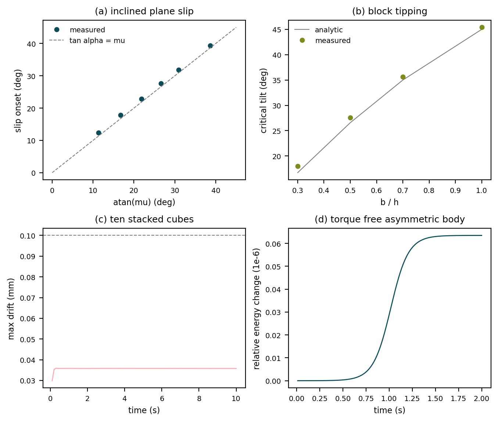
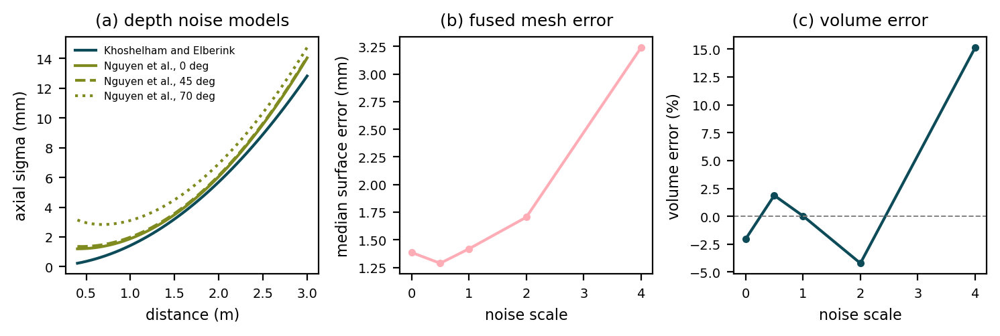
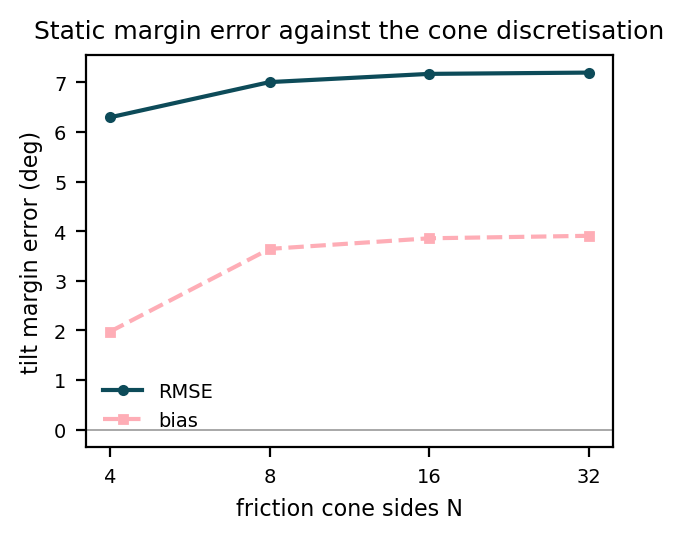
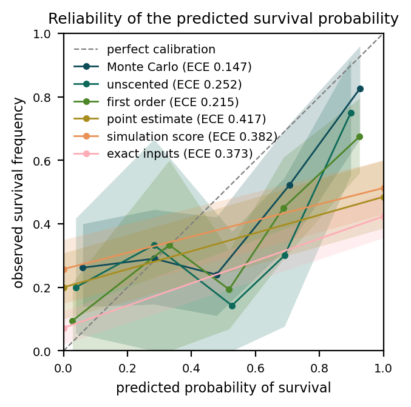
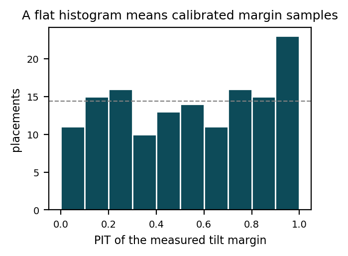
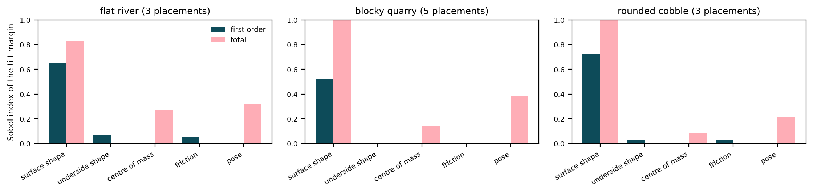
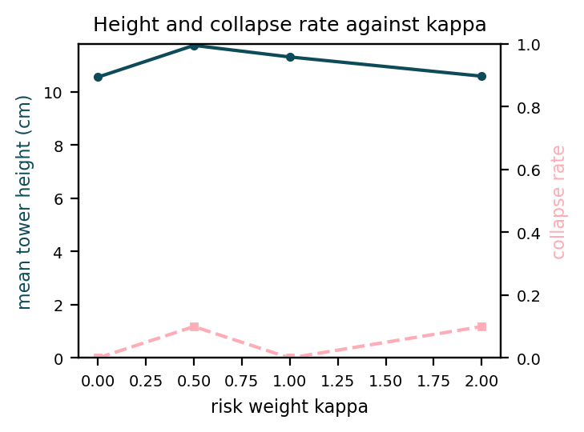
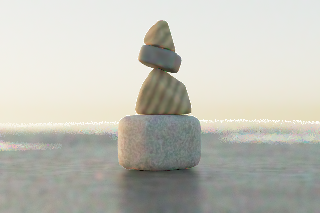
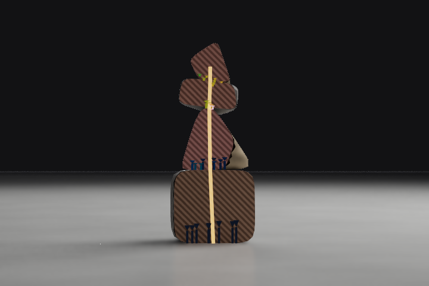
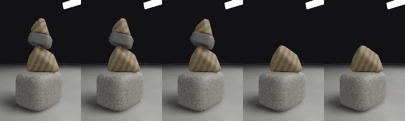

# Calibrated stone balancing: results

This report covers the implementation and the experiments of the technical specification
"Calibrated Stone Balancing with a Simulated Robot Arm". Design decisions and departures from
the specification are listed in `docs/DESIGN.md`. Every number below comes from a file under
`results/`, produced by the command named next to it.

## Summary

1. All eight modules are implemented and tested: 128 tests pass and one is skipped (PyBullet
   has no wheel for Python 3.13 on this machine).
2. With exact inputs, the static tilt margin predicts the dynamic critical tilt of a single stone
   on the ground well (Spearman 0.83, bias +2.7 degrees). For stacked stones it predicts
   systematically high (bias +4.3 degrees, Spearman 0.43): stones shift onto neighbouring hull
   vertices or roll on the stone below, and the 2 degree failure rule counts this as failure
   while the contact force program is still feasible.
3. Under perception, Monte Carlo propagation gives the best calibrated survival probability of
   the methods compared (expected calibration error 0.17 with 10 bins, 0.15 with 5 bins). The
   point estimate is overconfident (0.42), which supports hypothesis H2. The 0.05 target of H3
   is not reached.
4. Refining the friction cone from 4 to 32 sides increases the margin error. The cone
   discretisation is a smaller effect than the gap between static feasibility and dynamic
   stability, so H1 is not supported in this setup.
5. Shape uncertainty dominates the variance of the margin for every stone class (E3). Quadrupled
   depth noise lowers the towers from 9.4 to 3.2 cm and raises the Brier score from 0.17 to 0.29
   (E5). The risk weight has no measurable effect at 10 towers per value (E4).
6. The path tracer matches Mitsuba 3 on a shared scene (FLIP 0.003), and all twelve stills and
   nine videos are rendered from the recorded simulation at reduced resolution.

## Implementation

| Module | Package | Tests |
| --- | --- | --- |
| core (transforms, meshes, ray casting, configs, random streams) | `topple/core` | `tests/test_core.py` |
| stone generator | `topple/stonegen` | `tests/test_stonegen.py` |
| rigid body solver, collision, XPBD, merging, arm model | `topple/physics` | `tests/test_physics.py` |
| static analyser and margin model | `topple/statics` | `tests/test_statics.py` |
| depth sensor and estimator | `topple/perception` | `tests/test_perception.py` |
| planner and controller | `topple/planning` | `tests/test_planning.py` |
| path tracer | `topple/render` | `tests/test_render.py` |
| harness, evaluator, validation | `topple/harness`, `topple/eval`, `topple/validation` | `tests/test_harness.py`, `tests/test_eval.py`, `tests/test_validation.py`, `tests/test_guard.py` |
| end to end | `topple/pipeline.py` | `tests/test_integration.py` |

The package has about 18,000 lines of Python with numba kernels, 3,000 lines of scripts and
1,900 lines of tests (118 test functions, 129 test cases with parameters).

## Validation

**Physics (Section 12.1, `tests/test_physics.py`, figure F3).** A free body conserves linear
momentum to 1e-10 relative per step and the angular momentum magnitude to the same tolerance; a
torque free asymmetric body changes its energy by 6e-8 relative over 2 s. Frictionless sliding
conserves horizontal momentum. Contact impulses satisfy the polygonal cone to 1e-9 and the
complementarity residual of a resting stack is below 1e-6. On an inclined plane slip starts at
tan alpha = mu (measured about 1 degree late at the test sweep rate because failure is declared at
5 mm), the sliding acceleration matches g (sin alpha - mu cos alpha), and the tipping angle of a
block follows min(atan mu, atan b/h). Ten stacked cubes drift 0.04 mm in 10 s (limit 0.1 mm).
Sequential impacts in Newton's cradle pass the velocity to the last cube, simultaneous impacts
share it. Mass properties of cube, tetrahedron and sphere meshes match the closed forms and
converge under refinement.

**Cross engine (Section 12.2, `scripts/fig_engine_comparison.py`, figure F4).** On a single block
MuJoCo and Drake reproduce the analytic tipping angle within 3 degrees. On eight hand stacked
three stone towers settled in the developer's engine, MuJoCo agrees on the critical tilt within
about 1.5 degrees on five towers and differs by 4 to 5 degrees on two; settled poses after 1 s
agree to below 1 mm on six towers. Drake fails at or near zero tilt on six of the eight towers.
Its compliant point contact with regularised friction lets stacked hulls creep under static
load; the adapter passes the single block test, so the difference lies in how the engines treat
stacked convex contacts at rest.

**Static analyser (Section 12.3, `tests/test_statics.py`).** Block on a plane in the sliding and
tipping regimes (within 0.15 degrees with a 64 sided cone), block on a wedge, three block arch
(feasible with friction, infeasible without), invariance to mass scaling and to rotation about the
vertical, equilibrium of the minimum norm forces, dual based gradients against finite differences.

**Perception (Section 12.4, figures F5 and F6).** With exact depth, the fused surface is within
1.4 mm (median) of the true surface at 3 mm voxels; the error grows to 3.2 mm at four times the
nominal noise. With in hand views of the underside, the centre of mass error falls from 2.7 mm
(2 views) to 1.2 to 1.4 mm (8 to 12 views); without them it stays between 2 and 6.5 mm. Simulation
based calibration of the centre of mass posterior is checked in `tests/test_perception.py`.

**Renderer (Sections 10.9 and 12.5, figure R1).** The furnace test, sphere light irradiance, BVH
against brute force intersection and the motion blur of a rotating disc pass
(`tests/test_render.py`). On a shared scene of diffuse spheres and a box under a rectangular area
light, the developer's path tracer and Mitsuba 3 differ by a mean FLIP error of 0.003 (target
below 0.05) and by 0.4% in mean radiance (`scripts/fig_mitsuba_comparison.py`).

## Experiments

All experiments use `configs/study.yaml`: 24 towers per condition for E1 and E2, piles of 8
stones, 320 x 240 depth images, 64 Monte Carlo samples, tilt margins over 24 azimuths and dynamic
tilt tests over 6 azimuths. Every placement is tested by the dynamic harness on a clone holding
the ground and the tower. Probe placements (two per step, spread over predicted survival
probability, tested on clones and never kept) supply calibration data below the 0.95 chance
constraint; tower metrics use the building placements only. Placement uses the oracle lowering.

### E1 and E7: exact inputs (hypothesis H1)

`python scripts/run_experiment.py --condition E1all --profile study --workers 5 --tests tilt,fixed,push`

24 towers, 71 building placements and 170 probes. Towers reached 1 to 5 stones (mostly 3), with
a mean height of 12.4 cm and 2.75 stones placed before the first failure; 21% of towers collapsed
during a placement.

| Subset | n | Bias (deg) | RMSE (deg) | Spearman |
| --- | --- | --- | --- | --- |
| single stone on the ground | 72 | +2.7 | 5.0 | 0.83 |
| stacked stones | 112 | +4.3 | 8.0 | 0.43 |
| all | 184 | +3.6 | 7.0 | 0.62 |

The static margin is the critical angle of the current contact configuration. The dynamic test
declares failure at 5 mm or 2 degrees. Traces of individual towers show the upper stone pivoting
by 1 to 4 degrees onto nearby hull vertices well before the static program becomes infeasible,
and a rounded lower stone rolling more as the tower's centre of mass rises. Both count as failure.
This is the case the specification anticipates in Section 7.1: feasibility is necessary and in
general insufficient for stability.

**Margin definitions.** The push margin predicts the push test with a bias of +0.02 and an RMSE
of 0.15 (in units of the top stone's weight, Spearman 0.59). The support quality radius ranks the
critical tilt with Spearman 0.43 and the push test with 0.42; the support polygon margin ranks the
critical tilt with 0.56.

**Cone sides (E7).** Over the same placements:

| N | Bias (deg) | RMSE (deg) |
| --- | --- | --- |
| 4 | +2.0 | 6.3 |
| 8 | +3.6 | 7.0 |
| 16 | +3.9 | 7.2 |
| 32 | +3.9 | 7.2 |

A coarser cone under approximates friction and lowers the static margin, which partly offsets the
overestimate. H1 expected an error of order 10% falling with N; here the error is dominated by
the feasibility and stability gap.

### E2 and E8: perception and propagation (hypotheses H2, H3, question Q5)

`python scripts/run_experiment.py --condition E2all --profile study --workers 5`

24 towers, 24 building placements and 120 probes on the same perceived placements. Every tower
stopped after its first stone: no second stone met p_hat >= 0.95 under the perception posterior.

| Method | Brier | ECE (10 bins) | 95% coverage | RMSE (deg) |
| --- | --- | --- | --- | --- |
| Monte Carlo (64 samples) | 0.222 | 0.173 | 0.88 | 6.3 |
| first order | 0.253 | 0.228 | 0.90 | 7.5 |
| point estimate | 0.417 | 0.417 | 0.12 | 7.5 |
| simulation score (E8) | 0.382 | 0.382 | | 6.8 |

The unscented transform was first run with the scaling alpha = 1e-3, which gives the central
sigma point a weight near -1 / alpha^2 and fails on a margin that is piecewise smooth and often
exactly zero. It now uses alpha = 1, kappa = 0 (all weights positive). Its predictions were
recomputed by rerunning towers 0 to 11 (`scripts/run_ut_rerun.sh`): all 75 rerun placements
matched the original placements exactly, which also confirms that the random streams reproduce
a tower. On these 75 placements:

| Method | Brier | ECE (10 bins) | 95% coverage | RMSE (deg) |
| --- | --- | --- | --- | --- |
| Monte Carlo | 0.196 | 0.150 | 0.91 | 4.2 |
| unscented (2n + 1 sigma points) | 0.252 | 0.279 | 0.93 | 4.8 |

For question Q5, Monte Carlo is the better calibrated method at a similar cost (64 samples
against 2n + 1 = 45 to 89 sigma points for one or two stones, n = 22 per stone), and the first
order method lies between them.

The Monte Carlo Brier score decomposes into reliability 0.029, resolution 0.044 and uncertainty
0.239 (5 bins). Coverage at the 50, 80 and 95% levels is 0.44, 0.77 and 0.88, so the intervals
are slightly narrow; a Kolmogorov Smirnov test does not reject uniformity of the probability
integral transform (p = 0.11). The building placements are overconfident (mean p_hat 0.90, observed
survival 0.79) while the probes match in aggregate (0.33 and 0.32).

H2 is supported: the point estimate places its predictions at 0 or 1 and its reliability curve
lies below the diagonal at high predicted probability. H3 is not met at this scale: the Monte
Carlo ECE of 0.15 to 0.17 is above the 0.05 target, and the gap comes from the stacked placements,
where the static model is biased as in E1.

### E3: sources of margin variance (hypothesis H4)

`python scripts/fig_sobol.py --profile study --towers 2 --n 64 --max-stones 3`

The reduced posterior vector of every stone in the tower is split into five groups and a Saltelli
design (64 rows, 7 x 64 margin evaluations per placement) gives first order and total Sobol
indices, averaged over 3 to 5 placements per class.

| Class | Surface shape S / ST | Centre of mass ST | Friction ST | Pose ST |
| --- | --- | --- | --- | --- |
| flat river | 0.66 / 0.83 | 0.27 | 0.01 | 0.32 |
| blocky quarry | 0.52 / 1.20 | 0.14 | 0.01 | 0.38 |
| rounded cobble | 0.72 / 1.02 | 0.08 | 0.00 | 0.22 |

Shape uncertainty dominates the tilt margin variance for every class, followed by pose and the
centre of mass; the friction coefficient contributes almost nothing because the measured
failures are tipping and rocking. The underside group is empty: the in hand
views observe the underside, so every shape mode has most of its energy on observed surface.
H4 is therefore not supported as stated. With 64 design rows and few placements the estimates
carry visible noise (a total index above 1, small negative first order indices clipped to 0).

### E4: risk weight (hypothesis H5, question Q4)

`python scripts/run_kappa_sweep.py` through `scripts/run_followups.sh` (10 towers per value,
delta = 0.3 so that towers can grow under perception, fixed perturbation test only).

| kappa | Mean height (cm) | Stones before failure | Collapse rate | Placements surviving 3 degrees |
| --- | --- | --- | --- | --- |
| 0 | 10.5 | 1.7 | 0.0 | 0.41 |
| 0.5 | 11.7 | 1.9 | 0.1 | 0.41 |
| 1 | 11.3 | 1.8 | 0.0 | 0.36 |
| 2 | 10.6 | 1.6 | 0.1 | 0.42 |

The differences are within the sampling noise of 10 towers (one collapse moves the rate by 0.1),
so H5 is inconclusive at this scale. With delta = 0.3 a little under 60% of the placements fail
the 3 degree hold although no tower collapsed while being built, which again reflects the
optimistic static margin for stacked stones. A decision takes 200 to 290 s at study scale (8 pile
stones, 10 candidates each, dynamic settling and Monte Carlo screening).

### E5: depth noise and friction prior width

Cross design through the base point (noise scale 1, friction log sigma 0.25), 6 towers per point,
fixed perturbation test only (so only Brier and ECE are reported).

| Noise scale | Brier | ECE | Mean height (cm) |
| --- | --- | --- | --- |
| 0.5 | 0.205 | 0.235 | 8.7 |
| 1 | 0.167 | 0.129 | 9.4 |
| 2 | 0.166 | 0.177 | 6.0 |
| 4 | 0.289 | 0.269 | 3.2 |

| Friction log sigma | Brier | ECE |
| --- | --- | --- |
| 0.05 | 0.136 | 0.154 |
| 0.1 | 0.172 | 0.232 |
| 0.25 | 0.167 | 0.129 |
| 0.5 | 0.207 | 0.190 |

Four times the nominal depth noise degrades both scores and lowers the towers; the other
settings lie within the sampling noise of about 40 placements per point.

### E6: stone class

One run per class (6 towers each, tilt and fixed tests), and the class of the placed stone in E2.

| Class (own pile) | Brier | ECE | RMSE tilt (deg) | 95% coverage |
| --- | --- | --- | --- | --- |
| flat river | 0.206 | 0.213 | 6.2 | 0.94 |
| blocky quarry | 0.370 | 0.377 | 11.0 | 0.63 |
| rounded cobble | 0.149 | 0.261 | 2.1 | 0.97 |

Blocky stones are the hardest to predict: their flat faces give large static margins that the
dynamic tests do not reach, the E1 overestimate again, and their posterior intervals are too
narrow. Rounded cobbles have small margins that are predicted closely.

### Arm placement demonstration (milestones M8 and M9)

`python scripts/arm_demo.py --profile quick --towers 3 --max-stones 3` (results in
`results/arm_demo.json`)

The full chain runs: antipodal grasp selection on the stone, damped least squares IK to the
pre grasp, pick and approach poses, RRT-Connect around the inflated tower, finger closure, carry,
Cartesian impedance descent at 1 cm/s, contact detection from the wrist force, release and
retract. In the last demonstration the arm completed 4 of 6 placements; one fell back because
no contact was detected and one because the approach pose was in collision. Only one completed
placement landed close to its target (4.1 mm, 1.6 degrees); the others tumbled or were thrown at
release, and one tower collapsed. The release from a kinematically held stone to a free stone is
the weak point of the implementation; it does not affect the calibration experiments, which use
the oracle lowering.

## Hypotheses

| Hypothesis | Outcome at study scale |
| --- | --- |
| H1: with exact inputs the static tilt margin matches the critical tilt to the cone discretisation error | Not supported. Single stones: bias +2.7 degrees, Spearman 0.83. Stacks: bias +4.3 degrees. The error falls with a coarser cone, so the feasibility and stability gap dominates. |
| H2: a point estimate is overconfident | Supported (ECE 0.42, reliability below the diagonal at high probability). |
| H3: Monte Carlo is calibrated to ECE 0.05 and first order fails near zero margin | Monte Carlo is the best calibrated method (ECE 0.15 to 0.17) but misses 0.05; first order is worse (0.23). |
| H4: underside geometry dominates for flat stones, friction for blocky stones | Not supported: shape uncertainty on observed surface dominates for every class and friction contributes little (in hand views observe the underside). |
| H5: a lower confidence bound objective reduces collapses at a small height cost | Inconclusive at 10 towers per value. |

## Stills and videos

The showcase tower (`scripts/build_showcase.py --profile study --stone-class blocky_quarry`) is
four blocky stones, 26 cm tall, built with exact inputs; the planner stopped when no fifth stone
met the chance constraint. Its top stone was predicted at 5.9 degrees and measured at 0.7
degrees, the E1 pattern again.

Stills are rendered at 720 x 480 with 64 samples per pixel and the denoiser
(`scripts/render_stills.py all --width 720 --spp 64`), about 2 to 4 minutes each at 0.4 to 0.7
million rays per second while the experiments shared the machine. All twelve shots exist in
`results/stills` (H10 and H12 as a triptych and a strip plus their panels). The tilt and collapse
clips used by H6, H12, V3 and V4 were re-recorded on a world rebuilt from the stored stones with
mu = 0.6 for every pair (`scripts/reclip_showcase.py`), because the first clips stopped at 3 to 4
degrees of tilt.

The nine videos are in `results/videos` as H.265 MP4 files with their PNG frames, at 480 x 270,
8 samples per pixel with the denoiser, 24 frames per second and a 180 degree shutter
(`scripts/render_videos.py all --width 480 --spp 8`). Durations are shortened from the
specification: V1 1.5 s per stone, V2 4.5 s, V3 a 4x time lapse of the tilt to 10 degrees, V4
the collapse at 240 frames per second effective, V5 6 s of the shake, V6 to V9 3 s each.

An interactive WebGL viewer of the showcase tower with overlay toggles (extension 9 of Section 14)
is written by `scripts/export_viewer.py` to `results/viewer/tower_viewer.html`.

## Limitations

- The experiments run at study scale (24 towers per main condition), so the confidence bands in
  the reliability diagrams are wide.
- Towers under perception stop at one stone with delta = 0.05; tower growth under uncertainty is
  studied in E4 with delta = 0.3.
- The dynamic failure rule (5 mm or 2 degrees) and the static contact band (0.5 mm) interact, and
  the E1 bias depends on both.
- Calibration runs use the oracle lowering. The arm placement runs end to end but its release is
  unreliable (one accurate placement in six in the last demonstration).
- The decision times recorded in E1 and E2 include the probe placements and their tests; E4 to E6
  record the decision alone (14 to 290 s at study scale).
- Drake disagrees with the developer's engine and MuJoCo on stacked towers; PyBullet could not be
  installed for Python 3.13.
- The renders use reduced resolution and sample counts; the scripts accept the specification
  settings.
