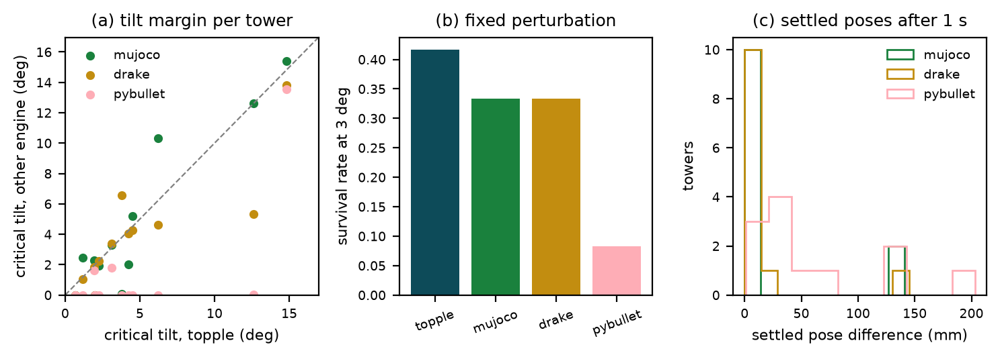
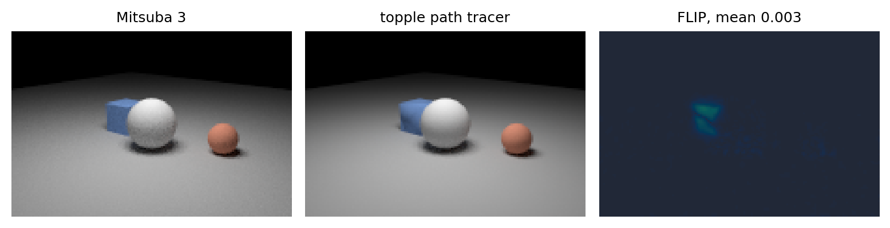
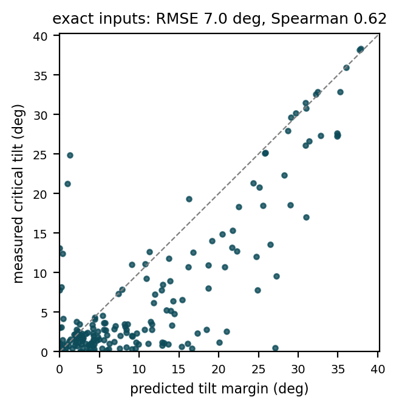
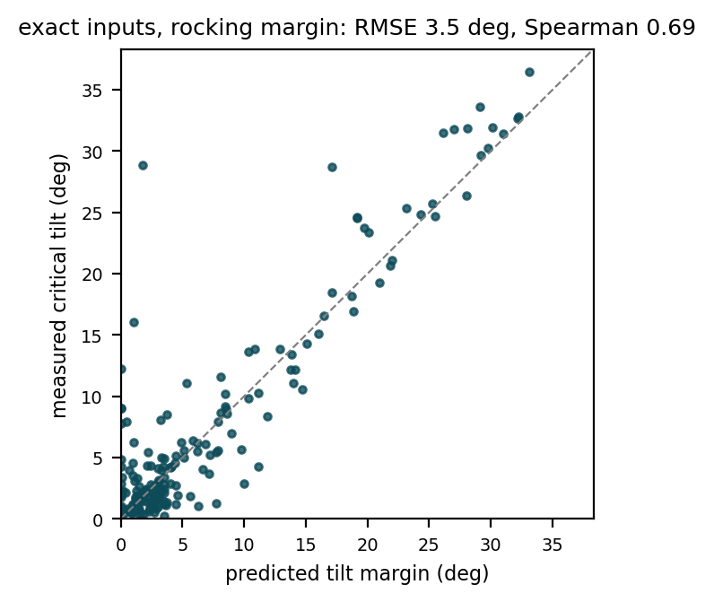
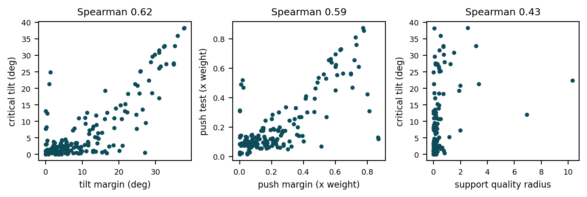
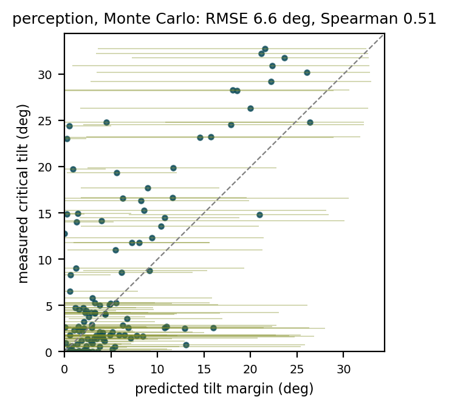
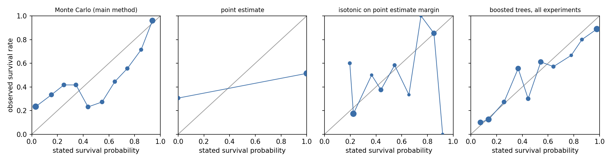
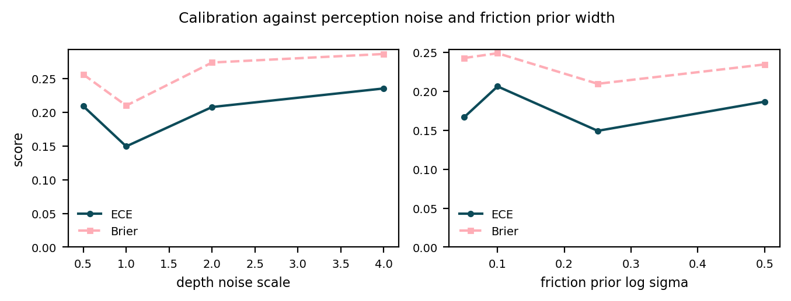
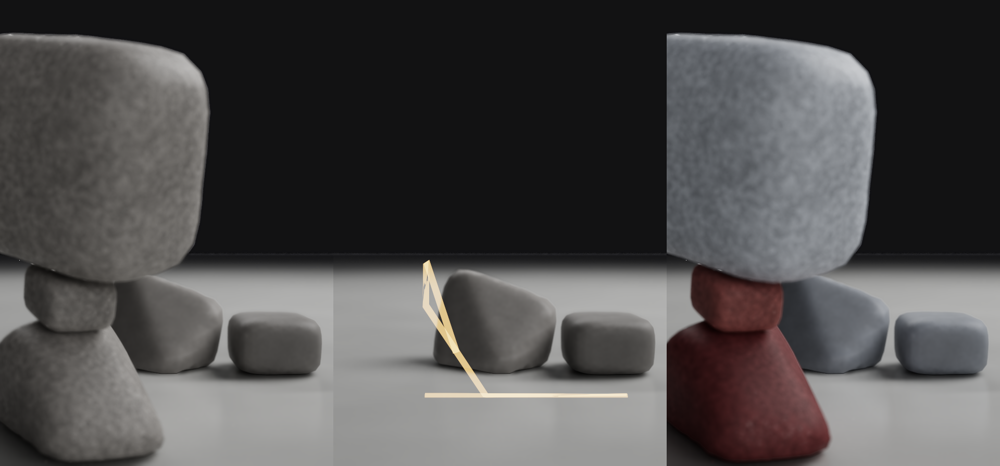

# Calibrated stone balancing: results

This report covers the implementation and the experiments of the technical specification
"Calibrated Stone Balancing with a Simulated Robot Arm". Design decisions and departures from
the specification are listed in `docs/DESIGN.md`. Every number below comes from a file under
`results/`, produced by the command named next to it. The first round of experiments and its
report are kept in `results/archive_v1/`.

## Summary

1. All eight modules are implemented and tested (138 test functions; in the full suite 151
   cases pass and 2 are skipped, the PyBullet cases, which pass in a separate Python 3.11
   environment).
2. With exact inputs, the static tilt margin ranks the dynamic critical tilt well for single
   stones (Spearman 0.83) and predicts high by about 3 degrees. The new rocking aware margin
   (Margin 4) removes most of that bias: bias -0.6 degrees and RMSE 3.5 degrees, compared with
   +3.2 and 6.1 degrees for the tilt margin over 193 placements.
3. Under perception, Monte Carlo propagation gives the best calibrated survival probability of
   the propagation methods (ECE 0.16, Brier 0.21). The point estimate is overconfident (0.44),
   which supports H2. The 0.05 target of H3 is not reached. With a looser chance constraint (delta 0.3,
   E2grow) towers under perception grow from 1.0 to 1.6 stones (6.5 to 10.2 cm) with no
   collapses, and Monte Carlo stays calibrated on the stacked placements (ECE 0.10; 0.056 after
   recalibration).
4. The final method adds a learned recalibration step to the Monte Carlo probability, trained on
   the outcomes of other experiments. Over 1,607 placements it lowers the Brier score from 0.236
   to 0.175 and the ECE from 0.165 to 0.048, and raises the AUC from 0.72 to 0.82. It helps in
   every experiment group except E4 (arm placement, delta 0.3), the group least like its training
   data. Among the baselines, a logistic curve on the point estimate margin matches the
   uncorrected Monte Carlo Brier score, and with exact shapes the tilt margin predicts survival
   better than the support polygon check (Brier 0.105 compared with 0.139).
5. Refining the friction cone from 4 to 32 sides increases the margin bias, so H1 is not
   supported in this setup.
6. Shape uncertainty dominates the margin variance (E3); the underside of the stone now
   contributes a total index of 0.34 to 0.65. Quadrupled depth noise lowers the towers from 6.8
   to 2.4 cm and raises the Brier score from 0.21 to 0.29 (E5). The risk weight has no
   measurable effect at 24 towers per value (E4).
7. The arm placed 95 of 142 stones in E4 itself (67%) and handed the rest to the oracle
   lowering, mostly when no grasp was found. In the study scale demonstration, the three
   placements the arm completed landed within 3 mm of the target.
8. MuJoCo and Drake agree with topple's engine on the critical tilt of twelve settled
   three stone towers (mean difference 1.4 degrees, Spearman 0.75 and 0.90).
   Replaying every E1all and E2all placement in MuJoCo and Drake, the two engines agree with
   topple's engine on 84 to 90% of outcomes and are stricter. The prediction methods rank the
   same way in all three engines, and the recalibrated Monte Carlo probability is the best
   calibrated in each (ECE 0.069 to 0.087 on E2all).
9. The path tracer matches Mitsuba 3 on a shared scene (FLIP 0.003). Twelve stills (1920 pixels
   wide) and nine videos (960 x 540) are rendered from the showcase tower.

## Implementation

| Module | Package | Tests |
| --- | --- | --- |
| core (transforms, meshes, ray casting, configs, random streams) | `topple/core` | `tests/test_core.py` |
| stone generator | `topple/stonegen` | `tests/test_stonegen.py` |
| rigid body solver, collision, XPBD, merging, arm model | `topple/physics` | `tests/test_physics.py` |
| static analyser and margin model | `topple/statics` | `tests/test_statics.py` |
| depth sensor and estimator | `topple/perception` | `tests/test_perception.py` |
| planner and controller | `topple/planning` | `tests/test_planning.py` |
| path tracer and sound | `topple/render` | `tests/test_render.py` |
| harness, evaluator, validation | `topple/harness`, `topple/eval`, `topple/validation` | `tests/test_harness.py`, `tests/test_eval.py`, `tests/test_validation.py`, `tests/test_guard.py` |
| end to end | `topple/pipeline.py` | `tests/test_integration.py` |

The package has about 20,000 lines of Python with numba kernels, 3,500 lines of scripts and
2,300 lines of tests.

## Validation

**Physics (Section 12.1, `tests/test_physics.py`, figure F3).** A free body conserves linear
momentum to 1e-10 relative per step and the angular momentum magnitude to the same tolerance; a
torque free asymmetric body changes its energy by 6e-8 relative over 2 s. Frictionless sliding
conserves horizontal momentum. Contact impulses satisfy the polygonal cone to 1e-9 and the
complementarity residual of a resting stack is below 1e-6. On an inclined plane slip starts at
tan alpha = mu (measured about 1 degree late at the test sweep rate because failure is declared at
5 mm), the sliding acceleration matches g (sin alpha - mu cos alpha), and the tipping angle of a
block follows min(atan mu, atan b/h). Ten stacked cubes drift 0.05 mm in 10 s (limit 0.1 mm).
Sequential impacts in Newton's cradle pass the velocity to the last cube, simultaneous impacts
share it. Mass properties of cube, tetrahedron and sphere meshes match the closed forms and
converge under refinement.

The contact query was revised for this round. Two convex hulls that touch exactly made the
penetration solver return an arbitrary normal, which let curved stones gain energy at rest; the
query now resolves touching hulls with a shifted distance query, and the contact manifold keeps
the load bearing points first.

**Cross engine (Section 12.2, `scripts/fig_engine_comparison.py`, figure F4).** On a single block
MuJoCo and Drake reproduce the analytic tipping angle within 3 degrees. Twelve three stone towers
were settled in topple's engine and then settled, tilted and perturbed in each engine:

| Engine | Critical tilt, mean difference (deg) | Spearman | Same fixed test outcome | Settled pose difference, median (mm) |
| --- | --- | --- | --- | --- |
| MuJoCo 4.0 | 1.4 | 0.75 | 11 of 12 | 0.3 |
| Drake (SAP, hydroelastic between stones) | 1.4 | 0.90 | 9 of 12 | 0.2 |
| PyBullet | 3.4 | 0.32 | 8 of 12 | 40 |

Two towers that hold at 0.7 and 2.0 degrees in topple's engine fall at zero tilt in both
MuJoCo and Drake, so they lie at the edge of stability. PyBullet does not hold 9 of the 12 towers
at zero tilt with its convex hull contact, so its row measures the engine setup more than the
towers.

**Static analyser (Section 12.3, `tests/test_statics.py`).** Block on a plane in the sliding and
tipping regimes (within 0.15 degrees with a 64 sided cone), block on a wedge, three block arch
(feasible with friction, infeasible without), invariance to mass scaling and to rotation about the
vertical, equilibrium of the minimum norm forces, dual based gradients against finite
differences. The rocking margin of a block matches the analytic tipping angle, and on a curved
support it lies below the tilt margin.

**Perception (Section 12.4, figures F5 and F6).** With exact depth, the fused surface is within
1.4 mm (median) of the true surface at 3 mm voxels; the error grows to 3.2 mm at four times the
nominal noise. With in hand views of the underside, the centre of mass error falls from 2.7 mm
(2 views) to 1.2 to 1.4 mm (8 to 12 views); without them it stays between 2 and 6.5 mm. Simulation
based calibration of the centre of mass posterior is checked in `tests/test_perception.py`. The
screened Poisson completion recovers the volume of a sphere within 1%.

**Renderer (Sections 10.9 and 12.5, figure R1).** The furnace test, sphere light irradiance, BVH
against brute force intersection and the motion blur of a rotating disc pass
(`tests/test_render.py`). Added in this round and tested there: the Hošek–Wilkie sky against the
reference formula, the spectral mode against RGB in a furnace, an invisible dielectric sphere in
a furnace, manifold next event estimation against the analytic irradiance under flat water, the
double Gauss lens (paraxial focal length 50.4 mm, exposure against a thin lens), and modal impact
sound. On a shared scene of diffuse spheres and a box under a rectangular area light, the
developer's path tracer and Mitsuba 3 differ by a mean FLIP error of 0.003 (target below 0.05)
and by 0.4% in mean radiance (`scripts/fig_mitsuba_comparison.py`).

## Experiments

All experiments use `configs/study.yaml`: 24 towers per condition, piles of 8 stones, 320 x 240
depth images, 64 Monte Carlo samples, tilt margins over 24 azimuths and dynamic tilt tests over 6
azimuths. Every placement is tested by the dynamic harness on a clone holding the ground and the
tower. Probe placements (two per step, spread over predicted survival probability, tested on
clones and never kept) supply calibration data below the 0.95 chance constraint; tower metrics
use the building placements only. E1, E2, E5 and E6 use the oracle lowering; E4 uses the arm.
The whole queue is `scripts/run_all_v2.sh` (log `results/logs/run_all_v2.log`).

### E1 and E7: exact inputs (hypothesis H1)

`python scripts/run_experiment.py --condition E1all --profile study --towers 24`

24 towers, 73 building placements and 173 probes. Ten towers reached 4 stones, six 3, seven 2 and
one 1, with a mean height of 13.9 cm and 2.8 stones placed before the first failure; 6 towers
(25%) collapsed during a placement.

| Margin | Subset | n | Bias (deg) | RMSE (deg) | Spearman |
| --- | --- | --- | --- | --- | --- |
| tilt | single stone on the ground | 71 | +3.6 | 6.2 | 0.83 |
| tilt | stacked stones | 122 | +3.0 | 6.0 | 0.58 |
| tilt | all | 193 | +3.2 | 6.1 | 0.70 |
| rocking (Margin 4) | single stone on the ground | 71 | -0.6 | 2.5 | 0.95 |
| rocking (Margin 4) | stacked stones | 122 | -0.6 | 4.0 | 0.46 |
| rocking (Margin 4) | all | 193 | -0.6 | 3.5 | 0.69 |

The tilt margin is the critical angle of the current contact configuration. The dynamic test
declares failure at 5 mm or 2 degrees, and stones pivot onto nearby hull vertices or roll on a
rounded support before the static program becomes infeasible. The rocking margin follows this:
it settles the hulls quasi statically under rotated gravity and applies the same 5 mm and 2
degree rule. Its survival probability (Brier 0.195, compared with 0.329 for the tilt margin)
is the better of the two on these placements.

**Margin definitions.** Spearman correlation with the measured critical tilt over the 193
placements: tilt 0.70, rocking 0.69, support polygon 0.65, force closure 0.39. The push test was
not run in this round; in the first round the push margin predicted it with a bias of +0.02 and an
RMSE of 0.15 top stone weights (`results/archive_v1`).

**Cone sides (E7).** Over the same placements:

| N | Bias (deg) | RMSE (deg) |
| --- | --- | --- |
| 4 | +1.7 | 5.6 |
| 8 | +3.2 | 6.1 |
| 16 | +3.4 | 6.2 |
| 32 | +3.5 | 6.2 |

A coarser cone under approximates friction and lowers the static margin, which partly offsets the
overestimate. H1 expected an error of order 10% falling with N; here the error is dominated by
the gap between static feasibility and dynamic stability.

### E2 and E8: perception and propagation (hypotheses H2, H3, question Q5)

`python scripts/run_experiment.py --condition E2all --profile study --towers 24`

24 towers, 25 building placements and 118 probes, with every method evaluated on the same
perceived placements. 23 towers stopped after their first stone: no second stone met
p_hat >= 0.95 under the perception posterior.

| Method | Brier | ECE (10 bins) | 95% coverage | RMSE (deg) |
| --- | --- | --- | --- | --- |
| Monte Carlo (64 samples) | 0.209 | 0.156 | 0.85 | 6.1 |
| Monte Carlo, rocking margin | 0.222 | 0.182 | 0.64 | 7.8 |
| unscented (2n + 1 sigma points) | 0.245 | 0.225 | 0.90 | 6.4 |
| first order | 0.257 | 0.219 | 0.81 | 7.8 |
| point estimate | 0.441 | 0.441 | 0.02 | 7.8 |
| simulation score (E8) | 0.441 | 0.441 | | 6.8 |

For question Q5, Monte Carlo is the better calibrated method at a similar cost (64 samples
compared with 2n + 1 = 45 to 89 sigma points for one or two stones, n = 22 per stone). The
unscented transform uses alpha = 1 and kappa = 0, which keeps every weight positive.

The Monte Carlo Brier score decomposes into reliability 0.029, resolution 0.064 and uncertainty
0.249 (5 bins). Coverage at the 50, 80 and 95% levels is 0.43, 0.70 and 0.85, so the intervals
are narrow, and a Kolmogorov Smirnov test rejects uniformity of the probability integral
transform (p = 6e-9). The mean margin is 2.3 degrees below the measured tilt: placements stated
near zero survive about a quarter of the time. In aggregate the building placements match (mean
p_hat 0.90, observed survival 0.92), and so do the probes (0.35 and 0.36).

H2 is supported: the point estimate places its predictions at 0 or 1, with a reliability of 0.20
compared with 0.03 for Monte Carlo. H3 is not met at this scale: the Monte Carlo ECE of 0.16 is
above the 0.05 target.

### Baselines for the survival probability

`python scripts/fig_baselines.py` (tables in `results/baselines/baselines.md`)

Each baseline is scored on the E2all placements with leave one tower out validation: the model
for tower t never sees tower t of any experiment, since experiments share stones by tower index.
Intervals are 95% bootstrap intervals over towers, and differences are paired.

| Method | Brier | ECE | AUC | Brier difference from Monte Carlo |
| --- | --- | --- | --- | --- |
| Monte Carlo (main method) | 0.209 | 0.156 | 0.75 | |
| point estimate | 0.441 | 0.441 | 0.58 | +0.231 [+0.147, +0.311] |
| logistic curve on the point estimate margin | 0.204 | 0.078 | 0.72 | -0.005 [-0.035, +0.022] |
| logistic curve on the Monte Carlo mean margin | 0.190 | 0.084 | 0.73 | -0.019 [-0.038, +0.000] |
| Monte Carlo, isotonic recalibration | 0.198 | 0.103 | 0.70 | -0.011 [-0.030, +0.008] |
| logistic regression, point estimate features (E2all only) | 0.186 | 0.094 | 0.79 | -0.023 [-0.057, +0.009] |
| boosted trees, all experiments (1,757 placements) | 0.170 | 0.074 | 0.83 | -0.039 [-0.077, -0.003] |

The Monte Carlo probability needs no outcome data. A curve fitted to a single margin reaches the
same Brier score once about 140 labelled outcomes from the same simulator are available, and a
classifier trained on the Monte Carlo summaries of 1,757 labelled placements does better. With
exact shapes (E1all), curve fits rank the margins as tilt and rocking (Brier 0.105 and 0.106),
push (0.116), support polygon (0.139) and force closure (0.185); the tilt margin is better than
the support polygon by 0.034 [0.018, 0.048].

### Final method: Monte Carlo with learned recalibration

`python scripts/fig_recalibration.py` (tables in `results/recalibration/recalibration.md`, module
`topple/eval/recalibration.py`)

The Monte Carlo outputs (probability, margin mean, interval and spread) and the placement context
(level, tower height, number of contacts, stone class and the experiment settings) go into a small
gradient boosted tree classifier that returns the corrected survival probability. This model was
chosen from the E2all baselines before the test below. Each experiment group is predicted by a
model trained on the other groups only, with tower indices held out; intervals are 95% bootstrap
intervals over towers.

| Test group | Placements | Brier, stated | Brier, recalibrated | Brier difference | ECE, stated | ECE, recalibrated | AUC, stated | AUC, recalibrated |
| --- | --- | --- | --- | --- | --- | --- | --- | --- |
| E2all | 143 | 0.209 | 0.168 | -0.041 [-0.081, -0.003] | 0.156 | 0.069 | 0.75 | 0.83 |
| E4 | 233 | 0.141 | 0.156 | +0.014 [-0.033, +0.061] | 0.109 | 0.123 | 0.88 | 0.89 |
| E5, off centre | 819 | 0.255 | 0.184 | -0.072 [-0.102, -0.043] | 0.180 | 0.074 | 0.67 | 0.80 |
| E6 | 412 | 0.259 | 0.170 | -0.088 [-0.120, -0.059] | 0.208 | 0.063 | 0.68 | 0.82 |
| all groups | 1,607 | 0.236 | 0.175 | -0.061 [-0.080, -0.041] | 0.165 | 0.048 | 0.72 | 0.82 |

Over all groups the ECE falls to 0.048 (interval 0.037 to 0.076), at the 0.05 target of H3, and
the AUC rises because the context separates placements the Monte Carlo probability ranks alike.
E4 differs from the training groups in three ways (arm placement, delta = 0.3 and risk weights
other than 1). There the stated probability is already well calibrated (Brier 0.141, ECE 0.11),
and the recalibration leaves it unchanged within the interval; a logistic recalibration on the
Monte Carlo outputs alone gives 0.124. The recalibrator therefore carries over to new noise
levels, friction priors and stone classes, and needs outcomes from the arm setting before it is
used there. Isotonic recalibration of the probability alone reaches a lower ECE (0.028) with a
smaller gain in Brier score (0.207) and no gain in AUC. The calibrator trained on every group is
saved in `results/recalibration/calibrator.pkl`.

### Predictions scored against MuJoCo and Drake

`python scripts/run_engine_truth.py --exp E1all` and `--exp E2all` (replays in
`results/engine_truth/<experiment>/`), then `python scripts/fig_engine_truth.py` (tables in
`results/engine_truth/engine_truth.md`)

Every placement of E1all and E2all (24 towers each) is rebuilt from its keyed random streams by
`topple/validation/replay.py`: the same stones, friction, pile and perceived offsets, with each
probe placed on a copy of the tower at its step and each building placement on the full tower.
The tower is exported to MuJoCo and Drake, settled for 1 s, and given the same tilt test and fixed
perturbation test. The stated predictions are then scored with each engine's outcome as the truth.
In topple's engine the replay reproduces 25 of 25 E2all and 64 of 67 E1all building placements
(largest critical tilt difference 3.4 degrees).

| Experiment | Engine | Survival rate | Same outcome as topple | Critical tilt, mean difference (deg) | Spearman |
| --- | --- | --- | --- | --- | --- |
| E1all (246 placements) | topple | 0.34 |  |  |  |
|  | MuJoCo | 0.25 | 0.84 | 2.37 | 0.79 |
|  | Drake | 0.23 | 0.87 | 1.93 | 0.83 |
| E2all (143 placements) | topple | 0.46 |  |  |  |
|  | MuJoCo | 0.41 | 0.85 | 2.16 | 0.84 |
|  | Drake | 0.38 | 0.90 | 1.77 | 0.86 |

| Experiment | Prediction | Brier, topple | Brier, MuJoCo | Brier, Drake | ECE, topple | ECE, MuJoCo | ECE, Drake |
| --- | --- | --- | --- | --- | --- | --- | --- |
| E1all | tilt margin | 0.329 | 0.427 | 0.427 | 0.329 | 0.427 | 0.427 |
| E1all | rocking margin | 0.195 | 0.260 | 0.236 | 0.195 | 0.260 | 0.236 |
| E2all | point estimate | 0.441 | 0.441 | 0.462 | 0.441 | 0.441 | 0.462 |
| E2all | unscented | 0.245 | 0.233 | 0.238 | 0.225 | 0.264 | 0.274 |
| E2all | Monte Carlo | 0.209 | 0.166 | 0.171 | 0.156 | 0.121 | 0.113 |
| E2all | rocking margin, Monte Carlo | 0.222 | 0.164 | 0.170 | 0.182 | 0.132 | 0.120 |
| E2all | Monte Carlo with learned recalibration | 0.168 | 0.130 | 0.158 | 0.069 | 0.074 | 0.087 |

With exact inputs the stated probability is 0 or 1, so Brier and ECE coincide for E1all. The
bootstrap intervals are in `results/engine_truth/engine_truth.md`.

MuJoCo and Drake agree with topple's engine on 84 to 90% of outcomes and are stricter: fewer
placements survive in both. The methods rank in the same order in all three engines. Under
perception, Monte Carlo scores better with MuJoCo or Drake as the truth (Brier 0.17) than with
topple's engine (0.21), and the recalibrated Monte Carlo probability is the best calibrated in
every engine (ECE 0.069 to 0.087). The recalibrator was trained on topple's outcomes from E4, E5
and E6 only, so the MuJoCo and Drake columns test it on outcomes from engines it has not seen.
With exact inputs both margins predict high compared with MuJoCo and Drake (bias +4.1 to +4.6
degrees for the tilt margin, +0.9 to +1.4 for the rocking margin), and the rocking margin keeps
the lower error (RMSE 3.8 to 4.2 degrees compared with 7.0). The calibration results therefore
hold with MuJoCo and Drake outcomes as the truth.

### E2grow: perception with a looser chance constraint

`python scripts/run_experiment.py --condition E2grow --profile study --towers 24 --delta 0.3`,
then `python scripts/fig_e2grow.py` (tables in `results/e2grow/e2grow.md`)

E2grow repeats E2all (perceived stones, Monte Carlo propagation, the same stones per tower index)
with the chance constraint p_hat >= 1 - delta at delta = 0.3 in place of 0.05, so that towers grow
under perception. The recalibration is trained on E4, E5 (off centre) and E6, with tower indices
held out.

| Experiment | Stones per tower (mean, max) | Height in cm (mean, max) | Collapses | Placements | Stacked placements |
| --- | --- | --- | --- | --- | --- |
| E2all, delta 0.05 | 1.04, 2 | 6.5, 12.5 | 0 | 143 | 71 |
| E2grow, delta 0.3 | 1.62, 3 | 10.2, 21.1 | 0 | 179 | 107 |

| Placements | Experiment | Survival rate | Monte Carlo: mean p, Brier, ECE | Recalibrated: Brier, ECE | Point estimate ECE |
| --- | --- | --- | --- | --- | --- |
| all | E2all | 0.46 | 0.45, 0.209, 0.156 | 0.168, 0.069 | 0.441 |
| all | E2grow | 0.39 | 0.40, 0.188, 0.103 | 0.163, 0.054 | 0.425 |
| on the ground | E2all | 0.56 | 0.67, 0.174, 0.141 | 0.129, 0.084 | 0.375 |
| on the ground | E2grow | 0.54 | 0.65, 0.175, 0.134 | 0.133, 0.092 | 0.389 |
| stacked | E2all | 0.37 | 0.22, 0.245, 0.190 | 0.207, 0.090 | 0.507 |
| stacked | E2grow | 0.28 | 0.22, 0.196, 0.101 | 0.183, 0.056 | 0.449 |

The looser constraint lets the towers grow by about half (1.6 stones and 10.2 cm on average, up to
3 stones and 21 cm) with no collapses. On the 107 stacked placements Monte Carlo has ECE 0.10 and
Brier 0.20, and the recalibrated probability has ECE 0.056. The E2grow and E2all intervals overlap
(stacked Monte Carlo ECE 0.074 to 0.218 compared with 0.134 to 0.315): calibration holds on the
taller towers, and separating the two experiments would need more towers. The
point estimate stays overconfident (ECE 0.43 to 0.45). Under perception, the rocking margin with
Monte Carlo gives ECE 0.165 compared with 0.103 for the tilt margin.

### E3: sources of margin variance (hypothesis H4)

`python scripts/fig_sobol.py --profile study --towers 4 --n 256 --max-stones 3`

The reduced posterior vector of every stone in the tower is split into five groups and a Saltelli
design (256 rows) gives first order and total Sobol indices, averaged over 5 to 7 placements per
class. A shape mode counts as underside when most of its energy lies on vertices whose normal
points down at the placed orientation.

| Class | Surface shape S / ST | Underside shape S / ST | Centre of mass ST | Friction ST | Pose ST |
| --- | --- | --- | --- | --- | --- |
| flat river | 0.46 / 0.87 | 0.12 / 0.34 | 0.20 | 0.05 | 0.29 |
| blocky quarry | 0.24 / 0.70 | 0.24 / 0.65 | 0.06 | 0.02 | 0.30 |
| rounded cobble | 0.37 / 0.84 | 0.12 / 0.43 | 0.16 | 0.00 | 0.19 |

Shape uncertainty dominates the tilt margin variance for every class. The underside carries as
much first order variance as the rest of the surface for blocky stones and about a quarter of it
for flat and rounded stones. Friction contributes little because the measured failures are
tipping and rocking. Total indices well above the first order indices show strong interactions
between the groups.

### E4: risk weight with arm placement (hypothesis H5, question Q4)

`python scripts/run_experiment.py --condition E4 --profile study --towers 24 --kappa K --delta 0.3 --probes 0 --tests fixed --placement arm`

24 towers per value, delta = 0.3 so that towers can grow under perception, fixed perturbation
test only. The arm grasps, carries and releases each stone; when grasp planning or the pick
fails, the placement falls back to the oracle lowering.

| kappa | Mean height (cm) | Stones before failure | Collapse rate | Building placements surviving 3 degrees | Placed by the arm |
| --- | --- | --- | --- | --- | --- |
| 0 | 8.8 | 1.50 | 0.08 | 0.66 | 23 of 38 |
| 0.5 | 8.7 | 1.42 | 0.00 | 0.71 | 22 of 34 |
| 1 | 8.6 | 1.33 | 0.08 | 0.65 | 24 of 34 |
| 2 | 9.6 | 1.46 | 0.04 | 0.58 | 26 of 36 |

The differences lie within the sampling noise of 24 towers (one collapse moves the rate by 0.04),
so H5 is inconclusive at this scale. Of the 47 fallbacks, 24 came from grasp planning (no
collision free grasp with a valid inverse kinematics solution) and 23 from the stone being
disturbed during the pick descent. A decision takes 48 to 56 s.

### E5: depth noise and friction prior width

Cross design through the base point (noise scale 1, friction log sigma 0.25), 24 towers per point,
fixed perturbation test only (so only Brier and ECE are reported).

| Noise scale | Brier | ECE | Mean height (cm) |
| --- | --- | --- | --- |
| 0.5 | 0.256 | 0.209 | 6.3 |
| 1 | 0.210 | 0.149 | 6.8 |
| 2 | 0.274 | 0.208 | 6.2 |
| 4 | 0.286 | 0.235 | 2.4 |

| Friction log sigma | Brier | ECE |
| --- | --- | --- |
| 0.05 | 0.243 | 0.167 |
| 0.1 | 0.249 | 0.206 |
| 0.25 | 0.210 | 0.149 |
| 0.5 | 0.235 | 0.187 |

Four times the nominal depth noise degrades both scores and lowers the towers to about a third
of their height. The base point gives the best scores on both axes; the other settings lie close
to each other at about 140 placements per point.

### E6: stone class

One run per class (24 towers each, tilt and fixed tests).

| Class (own pile) | Brier | ECE | Margin bias (deg) | RMSE tilt (deg) | 95% coverage |
| --- | --- | --- | --- | --- | --- |
| flat river | 0.218 | 0.138 | +0.1 | 6.2 | 0.92 |
| blocky quarry | 0.354 | 0.362 | -6.8 | 10.2 | 0.63 |
| rounded cobble | 0.205 | 0.251 | +0.7 | 2.6 | 0.91 |

Blocky stones are the hardest to predict under perception: the Monte Carlo margin lies 6.8
degrees below the measured tilt and the intervals are narrow. A likely cause, consistent with
the large underside share in E3, is that shape samples round off flat faces and so lower the
margin. Rounded cobbles have small margins that are predicted closely.

### Arm placement demonstration (milestones M8 and M9)

`python scripts/arm_demo.py --profile study --towers 3 --max-stones 3` (results in
`results/arm_demo.json`)

The full chain runs: antipodal grasp selection on the stone, damped least squares IK to the
pre grasp, pick and approach poses, RRT-Connect around the inflated tower, finger closure, carry,
Cartesian impedance descent at 1 cm/s, contact detection from the wrist force, a compliant
handover in which a force limited spring holds the stone to the hand and fades to zero while
the fingers open, and retract. At study scale the arm completed 3 of 7 placements, all three
within 2.8 mm and 0.05 degrees of the target, with no collapses; three placements found no
feasible grasp and one stone moved 7 mm during the pick descent. The quick profile demonstration
completed 7 of 8. Every completed release landed on target in both demonstrations; grasp
planning on irregular stones next to a tower is the step that most often fails.

## Hypotheses

| Hypothesis | Outcome at study scale |
| --- | --- |
| H1: with exact inputs the static tilt margin matches the critical tilt to the cone discretisation error | Not supported. Single stones: bias +3.6 degrees, Spearman 0.83. The bias grows with a finer cone, so the gap between feasibility and stability dominates. The rocking margin reduces the bias to -0.6 degrees. |
| H2: a point estimate is overconfident | Supported (ECE 0.44, predictions at 0 or 1). |
| H3: Monte Carlo is calibrated to ECE 0.05 and first order fails near zero margin | Monte Carlo alone is the best calibrated propagation method (ECE 0.16) and misses 0.05; first order is worse (0.22). With learned recalibration from other experiments the ECE over all groups is 0.048 (interval 0.037 to 0.076), and on E2all it is 0.074 and 0.087 with MuJoCo and Drake outcomes as the truth. |
| H4: underside geometry dominates for flat stones, friction for blocky stones | Not supported as stated. Surface shape dominates for every class; the underside matters most for blocky stones; friction contributes little. |
| H5: a lower confidence bound objective reduces collapses at a small height cost | Inconclusive at 24 towers per value (0 to 2 collapses per value). |

## Stills and videos

`python scripts/render_stills.py all --width 1920 --spp 512` and
`python scripts/render_videos.py all --width 960 --spp 16`

All renders come from the rebuilt showcase tower (`results/showcase`, 22.4 cm). The stills are
1920 x 1280 at 512 samples per pixel, except H5 (128, its volumetric ghosts are slow to trace),
H10 (three 640 x 896 panels) and H12 (five 384 x 576 frames). Render times are on the 12 core
CPU path tracer; the settings of each still are in the JSON file next to it.

| Still | Contents | Lens and transport | Minutes |
| --- | --- | --- | --- |
| H1 tower at dusk | sky, wet slab, sun caustics | thin lens, spectral, manifold NEE | 20 |
| H2 contact, and with forces | macro of the load bearing contact | traced double Gauss lens | 19 each |
| H3 arm at release | the arm opening its fingers | thin lens | 19 |
| H4 field of candidates | the pile, top view | thin lens | 14 |
| H5 posterior ghosts | shape samples of the next stone | thin lens, 128 samples | 71 |
| H6 collapse | 1/30 s exposure of the collapse | thin lens, spectral, manifold NEE | 24 |
| H7 section with thrust line | cut tower, contact forces | thin lens | 18 |
| H8 stability landscape | objective over the tower top | thin lens | 21 |
| H9 long exposure shake | trajectories of the shake test | thin lens | 21 |
| H10 triptych | beauty, section, density tint | thin lens | 16 |
| H11 hundred towers | one tile per E2all tower, tinted by outcome | orthographic | 18 |
| H12 tilt strip | five frames of the tilt test | thin lens | 38 (about 2 per frame; one frame ran under other load) |

The videos are 960 x 540 at 24 frames per second: V1 build (396 frames), V2 scan (108), V3 tilt
test (24), V4 collapse in slow motion with modal impact sound (144), V5 shake table (144), V6
hundred towers (72), V7 posterior to decision (72), V8 force flow (72) and V9 sweeping section
(72).

An interactive WebGL viewer of the showcase tower with overlay toggles (extension 9 of Section 14)
is written by `scripts/export_viewer.py` to `results/viewer/tower_viewer.html`.

## Limitations

- The experiments run at study scale (24 towers per condition), so the confidence bands in the
  reliability diagrams are wide.
- The main outcomes come from topple's engine. MuJoCo and Drake replays of E1all and E2all give
  the same calibration results, and fewer placements survive in both, so absolute survival rates
  depend on the engine.
- Towers under perception stop at about one stone with delta = 0.05. With delta = 0.3 (E2grow
  and E4) they reach 1.6 stones on average and 3 at most.
- The dynamic failure rule (5 mm or 2 degrees) and the static contact band (0.5 mm) interact, and
  the E1 bias depends on both.
- E1, E2, E5 and E6 use the oracle lowering. In E4 a third of the placements fall back to it.
- The decision times recorded in E1 and E2 include the probe placements and their tests.
- PyBullet does not hold most of the settled towers, so the engine comparison rests on MuJoCo and
  Drake.
- The Sobol indices average 5 to 7 placements per class.
- The recalibrator learns from labelled outcomes of similar experiments; in the arm setting (E4)
  it gives no improvement.
- The OIDN denoiser is not installed; the renders use the bilateral denoiser.
